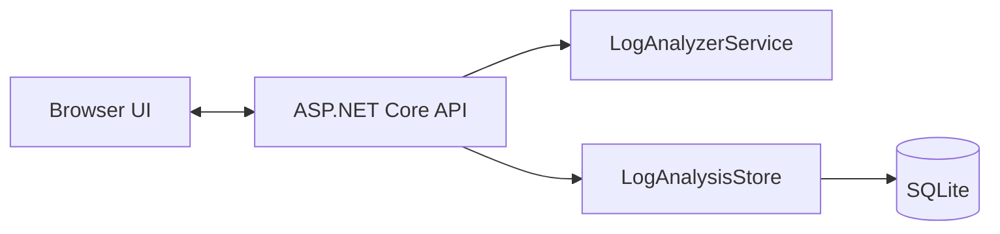

# LogTriage Assistant

A .NET 10 ASP.NET Core app for triaging runtime logs, application failures, dependency timeouts, and deployment issues.

## Features

- Paste log text directly into the browser UI
- Upload a log file from disk
- Detect likely failure categories and root-cause areas
- Preserve generic error and warning lines as actionable findings when no specific category matches
- Weigh multiple matching log signatures and flag performance, cache, and serialization issues
- Parse common JSON/JSONL log fields and attach .NET/Java/Python-style stack-trace continuation lines to one finding
- Include source timestamps and line ranges in findings when available
- Redact common credential assignments, bearer tokens, and email addresses in finding excerpts before results are returned or persisted
- Cap displayed findings at 500 per analysis while calculating overall severity across the full log
- Produce a summary with a heuristic signal score and severity (the score is not a calibrated probability)
- Suggest actions to investigate next
- Save recent analyses to a local SQLite database
- Reopen full saved results from the recent analyses list
- Delete saved analyses from history
- Search saved analyses by file name, summary, or finding and filter by severity
- Run analyzer unit and API integration tests with `dotnet test`
- Accept log text and file uploads up to 2 MB
- Run in Docker, with a GitHub Actions build check

## Technology and architecture

- **Backend:** .NET 10 and ASP.NET Core Minimal APIs
- **Analysis:** deterministic, explainable keyword-signature ranking with severity scoring
- **Persistence:** SQLite stores analysis results, not complete uploaded log files
- **Frontend:** static HTML, CSS, and JavaScript served by ASP.NET Core
- **Quality:** xUnit unit and API integration tests run in GitHub Actions
- **Packaging:** multi-stage Docker image



The analyzer weighs multiple category signatures on each line, keeps a maximum of 500 findings per result, and calculates overall severity across every matching line. Its rules are local and explainable; they are not an AI diagnosis.

## Run locally

```powershell
cd C:\Projects\LogTriageAssistant
dotnet restore
dotnet run
```

Open the local address printed by `dotnet run` in a browser. The SQLite database is created automatically at `App_Data\logtriage.db`.

Run the analyzer unit and API integration tests from the repository root with:

```powershell
dotnet test
```

To store the database elsewhere, set the `Storage__DatabasePath` environment variable before starting the app.
Saved history is limited to 1,000 analyses by default; set `Storage__MaxSavedAnalyses` to change that limit.

## Run with Docker

```powershell
docker build -t logtriage .
docker run --rm -p 127.0.0.1:8080:8080 -v logtriage-data:/app/App_Data logtriage
```

Open `http://localhost:8080`. The named Docker volume keeps the SQLite database when the container is replaced.

## Example API

### Analyze raw log text

```http
POST /api/analyze
Content-Type: application/json

{
  "logText": "2026-10-06 12:18:01 ERROR Failed to connect to database",
  "fileName": "sample.log"
}
```

### Upload a file

```powershell
curl.exe -F "file=@sample.log" http://localhost:8080/api/analyze-file
```

The upload field must be named `file`.

| Endpoint | Purpose |
| --- | --- |
| `GET /health` | Report application health |
| `POST /api/analyze` | Analyze JSON log text |
| `POST /api/analyze-file` | Analyze a multipart file upload |
| `GET /api/recent?limit=10` | Read recent saved analyses; limit is clamped to 1-100 |
| `DELETE /api/recent/{id}` | Delete one saved analysis |

## Current limitations

- Analysis uses local, explainable keyword rules; it does not send logs to an AI service.
- SQLite is intended for local/single-instance use. Multi-instance deployments need shared durable storage.
- The app does not include authentication. Keep it on a trusted machine/network and do not expose it directly to the public internet.
- Full uploaded log files are not stored. Saved results contain matched excerpts up to 220 characters after basic secret/email redaction; redaction uses patterns and cannot guarantee removal of every sensitive value.
- Saved analysis history is capped at 1,000 items by default. Configure `Storage__MaxSavedAnalyses` to change the cap; deletion and retention remove records from SQLite but do not securely overwrite database storage.
