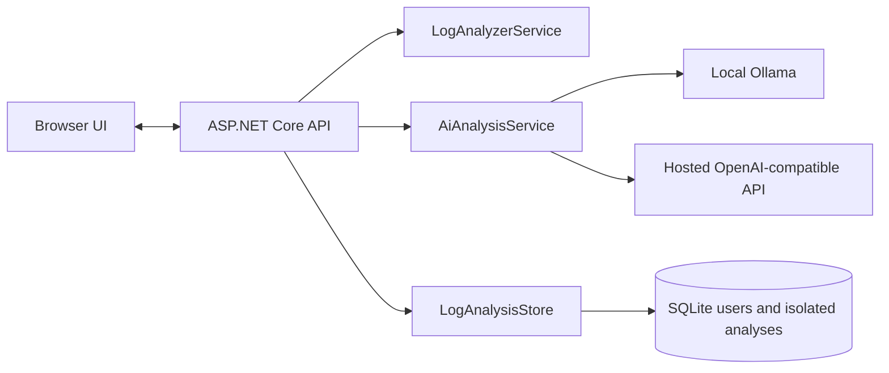

# LogTriage Assistant

A .NET 10 ASP.NET Core app for triaging runtime logs, application failures, dependency timeouts, and deployment issues.

## Features

- Paste log text directly into the browser UI
- Upload a log file from disk
- Detect likely failure categories and root-cause areas
- Preserve generic error and warning lines as actionable findings when no specific category matches
- Weigh multiple matching log signatures and flag performance, cache, and serialization issues
- Parse common JSON/JSONL log fields and attach .NET/Java/Python-style stack-trace continuation lines to one finding
- Include source timestamps and line ranges in findings when available
- Redact common credential assignments, bearer tokens, and email addresses in finding excerpts before results are returned or persisted
- Cap displayed findings at 500 per analysis while calculating overall severity across the full log
- Produce a summary with a heuristic signal score and severity (the score is not a calibrated probability)
- Suggest actions to investigate next
- Generate an optional AI incident brief with likely cause, impact, supporting evidence, and ordered investigation steps
- Choose local Ollama or a hosted OpenAI-compatible API; credentials stay on the server
- Redact supported secrets and email addresses from the full log before AI analysis; AI output is not saved to history
- Save recent analyses to a local SQLite database
- Search and filter all retained analyses with bounded, server-side pagination
- Reopen full saved results from the recent analyses list
- Delete saved analyses from history
- Check process liveness and database readiness independently
- Protect the application and analysis APIs with registered accounts, secure cookie sessions, CSRF protection, and rate-limited login attempts
- Support open account registration with server-hashed passwords and account-private saved analysis history
- Redact common credential assignments, provider token formats, database URL credentials, bearer tokens, and email addresses in matched excerpts
- Run analyzer unit and API integration tests with `dotnet test`
- Exercise the browser UI with Playwright end-to-end tests
- Accept log text and file uploads up to 2 MB
- Run in Docker, with a GitHub Actions build check

## Technology and architecture

- **Backend:** .NET 10 and ASP.NET Core Minimal APIs
- **Analysis:** deterministic, explainable keyword-signature ranking with severity scoring
- **Persistence:** SQLite stores analysis results, not complete uploaded log files
- **Frontend:** React 19, TypeScript, Vite 8, Tailwind CSS 4, and Lucide icons; built assets are served by ASP.NET Core
- **Quality:** xUnit unit and API integration tests run in GitHub Actions
- **Packaging:** multi-stage Docker image



The analyzer weighs multiple category signatures on each line, keeps a maximum of 500 findings per result, and calculates overall severity across every matching line. Its rules are local and explainable; they are not an AI diagnosis.

AI assistance is a separate, optional second opinion. The original log is redacted before it is sent to either provider. Ollama runs on the application host; the hosted provider receives the redacted log content. Redaction is pattern-based and cannot guarantee removal of all sensitive information. AI briefs are returned to the browser but are not persisted in analysis history.

## Run locally

```powershell
npm ci
npm run build
dotnet restore
dotnet build
$env:AdminAuth__Username = "admin"
$env:AdminAuth__PasswordHash = (dotnet run --no-build -- --hash-admin-password | Select-Object -Last 1)
dotnet run
```

The hash command prompts for a password without echoing it; use at least 12 characters. To keep a preconfigured administrator account, set both authentication variables as shown and store them in your secret manager or local environment, never in source control. Both may be omitted when using the public registration flow. Open the local address printed by `dotnet run` and create an account, or sign in with the configured administrator. Development mode allows local HTTP for convenience; production rejects non-HTTPS requests unless `AdminAuth:AllowHttp` is explicitly enabled for a loopback-only demo. The SQLite database is created automatically at `App_Data\logtriage.db`.

Registration is open: anyone who can reach the sign-up page can create an account. Usernames are case-insensitively unique; passwords must be at least 12 characters. Passwords are stored as ASP.NET Core password hashes, and each account's saved analyses are isolated from other accounts. Existing analyses are migrated to the configured legacy administrator account. Signup is CSRF-protected and rate-limited to five attempts per source IP per minute. For a public deployment, use HTTPS and consider whether open registration is appropriate for your service.

Production login attempts are limited to five per source IP per minute by default; configure `AdminAuth__LoginAttemptsPerMinute` if needed. Behind a TLS-terminating reverse proxy, set `AdminAuth__TrustedProxy` to the proxy's IP address so the app trusts its forwarded HTTPS scheme. Do not trust forwarded headers from arbitrary proxies.

Run the analyzer unit and API integration tests from the repository root with:

```powershell
dotnet test
```

Run the browser end-to-end tests with:

```powershell
npm ci
npm run build
dotnet build --configuration Release
npx playwright install chromium
npm run test:e2e
```

The browser tests start an isolated app process and temporary SQLite database; they do not use the app's local history. `npm run build` type-checks TypeScript and emits the production React bundle into `wwwroot`; rerun it after frontend changes. The Docker build runs this frontend build in a Node stage automatically.

To store the database elsewhere, set the `Storage__DatabasePath` environment variable before starting the app.
Saved history is limited to 1,000 analyses by default; set `Storage__MaxSavedAnalyses` to change that limit.

## Configure AI analysis

The AI brief controls appear after sign-in. Provider URLs, model names, and keys are configured on the server; API keys are never sent to the browser. Choose the local Ollama option to keep log content on the application host:

```powershell
ollama pull qwen2.5:3b
$env:Ai__Ollama__BaseUrl = "http://localhost:11434"
$env:Ai__Ollama__Model = "qwen2.5:3b"
```

The app uses the Ollama server reachable from its own process. When running in Docker, `localhost` means the container; set `Ai__Ollama__BaseUrl` to an address reachable from the container.

To enable a hosted OpenAI-compatible endpoint instead, configure the API base URL (including its version path where applicable), model, and secret key:

```powershell
$env:Ai__OpenAICompatible__BaseUrl = "https://api.openai.com/v1"
$env:Ai__OpenAICompatible__Model = "your-model"
$env:Ai__OpenAICompatible__ApiKey = "your-server-side-secret"
```

The UI allows switching between providers when both are configured. Hosted use sends redacted log content to that service; review its data retention and processing terms before use. Never put provider keys in source control or browser code. Ollama is the default local provider configuration; hosted AI remains unavailable until all three hosted settings are set.

## Run with Docker

```powershell
docker build -t logtriage .
docker run --rm -p 127.0.0.1:8080:8080 -v logtriage-data:/app/App_Data `
  -e AdminAuth__Username="$env:AdminAuth__Username" `
  -e AdminAuth__PasswordHash="$env:AdminAuth__PasswordHash" `
  -e AdminAuth__AllowHttp=true logtriage
```

Generate the hash on the host as described above, then set the environment variables before starting the container. `AdminAuth__AllowHttp=true` is only for this loopback-bound local demo; do not use it on a network-facing deployment. For remote access, terminate TLS at a trusted reverse proxy, set `AdminAuth__TrustedProxy` to that proxy's IP so forwarded HTTPS is trusted, and leave HTTP disabled. Authentication cookies are Secure-only. The named Docker volume keeps SQLite history when the container is replaced. The GitHub Actions workflow builds and smoke-tests the authenticated container, including persistence across a restart.

## Example API

### Analyze raw log text

```http
POST /api/analyze
Content-Type: application/json

{
  "logText": "2026-10-06 12:18:01 ERROR Failed to connect to database",
  "fileName": "sample.log"
}
```

### Upload a file

```powershell
curl.exe -F "file=@sample.log" http://localhost:8080/api/analyze-file
```

The upload field must be named `file`.

| Endpoint | Purpose |
| --- | --- |
| `GET /health` | Report process liveness |
| `GET /health/ready` | Check that the app can access its SQLite database |
| `GET /api/auth/csrf` | Issue an anti-forgery request token |
| `POST /api/auth/login` | Sign in to a configured administrator or registered account |
| `POST /api/auth/register` | Create an account and start a session |
| `POST /api/auth/logout` | Sign out and clear the session cookie |
| `GET /api/auth/status` | Return the signed-in admin name |
| `GET /api/ai/providers` | List supported AI providers and whether each is configured |
| `POST /api/ai/analyze` | Return an AI incident brief for redacted log text; result is not persisted |
| `POST /api/analyze` | Analyze JSON log text |
| `POST /api/analyze-file` | Analyze a multipart file upload |
| `GET /api/recent?limit=10` | Read recent saved analyses; limit is clamped to 1-100 |
| `GET /api/history?page=1&pageSize=20&search=timeout&severity=HIGH` | Search/filter retained analyses with paging; page size is clamped to 1-50 |
| `GET /api/recent/{id}` | Read one saved analysis |
| `DELETE /api/recent/{id}` | Delete one saved analysis |

Except for health checks and the sign-in, registration, and CSRF endpoints, API requests require an authenticated cookie session. API write requests, including registration and AI analysis, also require the token returned by `GET /api/auth/csrf` in the `X-CSRF-TOKEN` header; the browser UI manages both automatically.

## Current limitations

- Rule-based analysis is local and explainable. AI analysis is optional and sends the log after best-effort pattern-based redaction to the selected provider; it should be treated as an unverified hypothesis.
- SQLite is intended for a single application instance using local persistent storage. Multi-instance deployments need shared durable storage and coordinated retention.
- Registration is open and usernames are not email-verified. There is no email recovery, administrator console, account lockout, or role management. Login and signup rate limiting is in-memory and intended for a single instance; sessions are eight hours with sliding renewal.
- User accounts and analysis ownership are stored in SQLite. SQLite is intended for a single application instance using local persistent storage; multi-instance deployments need shared durable storage and coordinated rate limiting.
- Always use HTTPS for remote deployments. Secure-only cookies are not sent over ordinary remote HTTP.
- Full uploaded log files are not stored. Saved results contain matched excerpts up to 220 characters after pattern-based redaction; AI receives the full log after the same best-effort redaction. Redaction cannot guarantee removal of every sensitive value. Review logs and results before sharing them.
- Saved analysis history is capped at 1,000 items by default. Configure `Storage__MaxSavedAnalyses` to change the cap; deletion and retention remove records from SQLite but do not securely overwrite database storage.
- History search operates on saved analysis JSON and is bounded by the retention cap; it is not a full-text log archive.
- Container smoke tests run in GitHub Actions. A local Docker engine is not required for the .NET and browser tests, but is required to run the Docker commands above.
