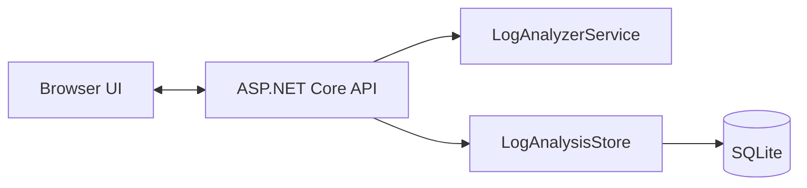

# LogTriage Assistant

A .NET 10 ASP.NET Core app for triaging runtime logs, application failures, dependency timeouts, and deployment issues.

## Features

- Paste log text directly into the browser UI
- Upload a log file from disk
- Detect likely failure categories and root-cause areas
- Preserve generic error and warning lines as actionable findings when no specific category matches
- Weigh multiple matching log signatures and flag performance, cache, and serialization issues
- Parse common JSON/JSONL log fields and attach .NET/Java/Python-style stack-trace continuation lines to one finding
- Include source timestamps and line ranges in findings when available
- Redact common credential assignments, bearer tokens, and email addresses in finding excerpts before results are returned or persisted
- Cap displayed findings at 500 per analysis while calculating overall severity across the full log
- Produce a summary with a heuristic signal score and severity (the score is not a calibrated probability)
- Suggest actions to investigate next
- Save recent analyses to a local SQLite database
- Search and filter all retained analyses with bounded, server-side pagination
- Reopen full saved results from the recent analyses list
- Delete saved analyses from history
- Check process liveness and database readiness independently
- Protect the application and analysis APIs with a single-admin sign-in, secure cookie sessions, CSRF protection, and rate-limited login attempts
- Redact common credential assignments, provider token formats, database URL credentials, bearer tokens, and email addresses in matched excerpts
- Run analyzer unit and API integration tests with `dotnet test`
- Exercise the browser UI with Playwright end-to-end tests
- Accept log text and file uploads up to 2 MB
- Run in Docker, with a GitHub Actions build check

## Technology and architecture

- **Backend:** .NET 10 and ASP.NET Core Minimal APIs
- **Analysis:** deterministic, explainable keyword-signature ranking with severity scoring
- **Persistence:** SQLite stores analysis results, not complete uploaded log files
- **Frontend:** static HTML, CSS, and JavaScript served by ASP.NET Core
- **Quality:** xUnit unit and API integration tests run in GitHub Actions
- **Packaging:** multi-stage Docker image



The analyzer weighs multiple category signatures on each line, keeps a maximum of 500 findings per result, and calculates overall severity across every matching line. Its rules are local and explainable; they are not an AI diagnosis.

## Run locally

```powershell
dotnet restore
dotnet build
$env:AdminAuth__Username = "admin"
$env:AdminAuth__PasswordHash = (dotnet run --no-build -- --hash-admin-password | Select-Object -Last 1)
dotnet run
```

The hash command prompts for a password without echoing it; use at least 12 characters. The app refuses to start unless both authentication settings are configured. Store the username and generated hash in your deployment secret manager or local environment, never in source control. Open the local address printed by `dotnet run` in a browser and sign in with the same password. Development mode allows local HTTP for convenience; production rejects non-HTTPS requests unless `AdminAuth:AllowHttp` is explicitly enabled for a loopback-only demo. The SQLite database is created automatically at `App_Data\logtriage.db`.

Production login attempts are limited to five per source IP per minute by default; configure `AdminAuth__LoginAttemptsPerMinute` if needed. Behind a TLS-terminating reverse proxy, set `AdminAuth__TrustedProxy` to the proxy's IP address so the app trusts its forwarded HTTPS scheme. Do not trust forwarded headers from arbitrary proxies.

Run the analyzer unit and API integration tests from the repository root with:

```powershell
dotnet test
```

Run the browser end-to-end tests with:

```powershell
dotnet build --configuration Release
npm ci
npx playwright install chromium
npm run test:e2e
```

The browser tests start an isolated app process and temporary SQLite database; they do not use the app's local history.

To store the database elsewhere, set the `Storage__DatabasePath` environment variable before starting the app.
Saved history is limited to 1,000 analyses by default; set `Storage__MaxSavedAnalyses` to change that limit.

## Run with Docker

```powershell
docker build -t logtriage .
docker run --rm -p 127.0.0.1:8080:8080 -v logtriage-data:/app/App_Data `
  -e AdminAuth__Username="$env:AdminAuth__Username" `
  -e AdminAuth__PasswordHash="$env:AdminAuth__PasswordHash" `
  -e AdminAuth__AllowHttp=true logtriage
```

Generate the hash on the host as described above, then set the environment variables before starting the container. `AdminAuth__AllowHttp=true` is only for this loopback-bound local demo; do not use it on a network-facing deployment. For remote access, terminate TLS at a trusted reverse proxy, set `AdminAuth__TrustedProxy` to that proxy's IP so forwarded HTTPS is trusted, and leave HTTP disabled. Authentication cookies are Secure-only. The named Docker volume keeps SQLite history when the container is replaced. The GitHub Actions workflow builds and smoke-tests the authenticated container, including persistence across a restart.

## Example API

### Analyze raw log text

```http
POST /api/analyze
Content-Type: application/json

{
  "logText": "2026-10-06 12:18:01 ERROR Failed to connect to database",
  "fileName": "sample.log"
}
```

### Upload a file

```powershell
curl.exe -F "file=@sample.log" http://localhost:8080/api/analyze-file
```

The upload field must be named `file`.

| Endpoint | Purpose |
| --- | --- |
| `GET /health` | Report process liveness |
| `GET /health/ready` | Check that the app can access its SQLite database |
| `GET /api/auth/csrf` | Issue an anti-forgery request token |
| `POST /api/auth/login` | Sign in with the configured admin username and password |
| `POST /api/auth/logout` | Sign out and clear the session cookie |
| `GET /api/auth/status` | Return the signed-in admin name |
| `POST /api/analyze` | Analyze JSON log text |
| `POST /api/analyze-file` | Analyze a multipart file upload |
| `GET /api/recent?limit=10` | Read recent saved analyses; limit is clamped to 1-100 |
| `GET /api/history?page=1&pageSize=20&search=timeout&severity=HIGH` | Search/filter retained analyses with paging; page size is clamped to 1-50 |
| `GET /api/recent/{id}` | Read one saved analysis |
| `DELETE /api/recent/{id}` | Delete one saved analysis |

Except for health checks and the sign-in/CSRF endpoints, API requests require an authenticated cookie session. API write requests also require the token returned by `GET /api/auth/csrf` in the `X-CSRF-TOKEN` header; the browser UI manages both automatically.

## Current limitations

- Analysis uses local, explainable keyword rules; it does not send logs to an AI service.
- SQLite is intended for a single application instance using local persistent storage. Multi-instance deployments need shared durable storage and coordinated retention.
- Authentication is a single configured administrator, not a multi-user identity system. Login rate limiting is in-memory and intended for a single instance; sessions are eight hours with sliding renewal.
- Always use HTTPS for remote deployments. Secure-only cookies are not sent over ordinary remote HTTP.
- Full uploaded log files are not stored. Saved results contain matched excerpts up to 220 characters after pattern-based redaction; redaction cannot guarantee removal of every sensitive value. Review logs and results before sharing them.
- Saved analysis history is capped at 1,000 items by default. Configure `Storage__MaxSavedAnalyses` to change the cap; deletion and retention remove records from SQLite but do not securely overwrite database storage.
- History search operates on saved analysis JSON and is bounded by the retention cap; it is not a full-text log archive.
- Container smoke tests run in GitHub Actions. A local Docker engine is not required for the .NET and browser tests, but is required to run the Docker commands above.
